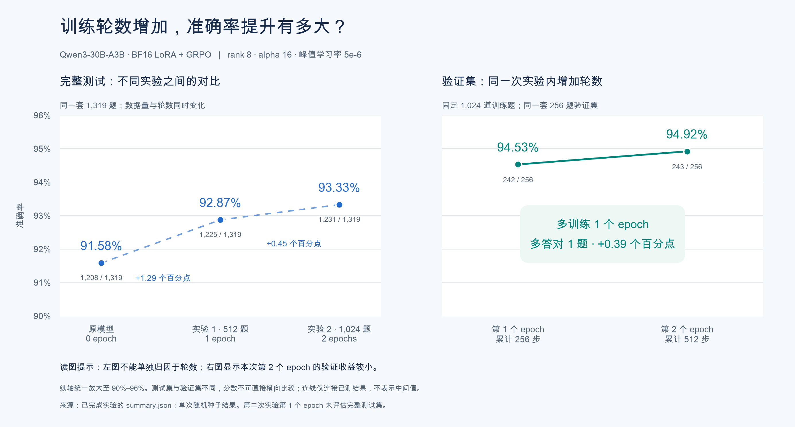

# Qwen3-30B-A3B：单卡 BF16 LoRA＋GRPO

截至 2026-10-23，两轮训练、完整 GSM8K 测试集评估和回答采样诊断均已完成。完整 1319 题的严格答案准确率为 **91.58% → 92.87% → 93.33%**。第二轮比第一轮净多答对 6 题，尚不能据此确认稳定收益。后续扩大有效训练样本的方案仍是待办，没有启动第三轮训练。

本目录保存代码、配置、小型结果汇总与图表；`runs/` 中的原始题目、回答、adapter、日志与环境快照不纳入 Git。结果来自已完成的远端实验，本次归档没有重新训练。

## 数据与已完成结果

GSM8K 官方 train 共 7473 题，test 共 1319 题。第一轮只抽取 512 道训练题；第二轮使用 1024 道训练题（包含原 512 题），另从 train 留出 256 道验证题。因此还有 **6193 道符合当前筛选条件、未用于第二轮训练或验证的候选题**。训练两轮是对同一批题重复学习，不等于获得两倍不同的题目。

| 模型 | 训练题数 | epoch | 优化器更新步数 | 完整测试正确数 | 准确率 | 相比前一实验 |
|---|---:|---:|---:|---:|---:|---:|
| 原始底座 | 0 | 0 | 0 | 1208/1319 | 91.58% | — |
| 第一轮 LoRA | 512 | 1 | 128 | 1225/1319 | 92.87% | +1.29 个百分点 |
| 第二轮 LoRA | 1024 | 2 | 512 | 1231/1319 | 93.33% | +0.45 个百分点 |

两轮均从原始底座和新的 LoRA 开始；第二轮没有接着第一轮 adapter 训练。评估保持同一套 1319 题、顺序、提示词和评分规则：非 thinking、greedy、每题一个回答、最多 512 tokens。第二轮按独立验证集选模型，同分保留较早轮次，选定后只评估一次完整测试集。

| 第二轮内部验证 | 累计步数 | 验证正确数 | 验证准确率 |
|---|---:|---:|---:|
| 第 1 个 epoch | 256 | 242/256 | 94.53% |
| 第 2 个 epoch（选中） | 512 | 243/256 | 94.92% |

第一轮相对底座：29 题错变对、12 题对变错，配对 McNemar 双侧 p=0.01151。第二轮相对第一轮：21 题错变对、15 题对变错，p=0.40503，单次随机种子结果没有建立稳定提升的证据。跨实验同时改变了数据量与轮数，不能把全部变化归因于 epoch；第二轮第 1 个 epoch 没有评估完整测试集。



数据来源：[第一轮全量评估](reports/round1_full_eval.json)、[第二轮汇总](reports/round2_summary.json)。首轮最初的 128 题成绩为 90.625% → 92.1875%，后续以完整 1319 题的可比结果为主。

## 模型、LoRA 与更新配置

使用原始 `Qwen/Qwen3-30B-A3B`：BF16 底座、无 4-bit/8-bit 量化，单卡 A800 80GB。Unsloth 优化 MoE 计算，TRL 执行 GRPO；禁用 vLLM，参考策略在同一底座上暂时关闭 adapter，避免两份完整权重常驻。

| 项目 | 两轮共同配置 |
|---|---|
| LoRA | rank=8、alpha=16、dropout=0；缩放 alpha/r=2 |
| 目标模块 | q/k/v/o_proj、gate/up/down_proj、gate_up_proj，包含 MoE 专家 |
| 参数量 | 底座 30,532,122,624；可训练 LoRA 321,257,472，其中专家 LoRA 314,572,800 |
| 优化器与学习率 | AdamW；峰值 5e-6，5% warmup，cosine 衰减到 0，梯度裁剪 1.0 |
| GRPO | 每题生成 4 个回答；generation batch=8；micro batch=1；梯度累积 16；KL beta=0.04 |
| 采样 | temperature=0.7、top_p=0.8、top_k=20 |
| 长度 | prompt 上限 768、回答上限 512 tokens；关闭 thinking |
| 奖励 | 复用 `../qwen7b_grpo/rewards.py`：唯一末尾 `<answer>NUMBER</answer>`，精确数值匹配；二值 0/1 |
| 随机种子 | 42 |

每个优化器步骤消化 16 条生成回答，即 4 次题目访问，所以第一轮为 `512 × 1 ÷ 4 = 128` 步，第二轮为 `1024 × 2 ÷ 4 = 512` 步。`generation_batch_size=8` 是生成批次大小，不是每次优化器更新的题数。

真实模型短跑与正式训练均确认注意力和专家 LoRA 有实际更新。第一轮训练阶段约 3 小时 33 分，第二轮训练阶段约 13 小时 55 分（另有验证和测试时间）；峰值保留显存约 63.2GiB。这些是当前长度、批次和依赖下的实测，不代表更长上下文仍有相同显存需求。

远端成功环境：Torch 2.10.0+cu128、Transformers 5.3.0、Unsloth 2026.10.7、TRL 0.22.2、PEFT 0.21.2。设置 `UNSLOTH_COMPILE_DISABLE=1` 避开编译路径与梯度检查点的重算冲突，MoE 保留 `unsloth_triton` 内核。`requirements.txt` 含版本范围，不是完整冻结的环境锁；重新安装仍需导入检查和真实短跑。

## 有效训练信号诊断

历史训练没有保存完整回答文本。`audit_reward_groups.py` 根据二值奖励均值、组内标准差和零方差比例，唯一重建 512 步的组计数；遇到歧义会报错。统计单位是题目访问次数，不是去重题数，也无法还原具体题目或历史文本重复率。

| 第二轮训练阶段 | 4 个回答全对 | 全为零奖励 | 部分答对 | 总题目访问次数 |
|---|---:|---:|---:|---:|
| epoch 1 | 928（90.63%） | 47（4.59%） | 49（4.79%） | 1024 |
| epoch 2 | 951（92.87%） | 40（3.91%） | 33（3.22%） | 1024 |
| 合计 | 1879（91.75%） | 87（4.25%） | 82（4.00%） | 2048 |

全对与全零奖励组没有正确性奖励的组内差异；KL 项仍可能有梯度。零奖励也包含格式错误，不一定是算错。来源：[训练奖励组汇总](reports/round2_reward_groups.json)。

随后固定第二轮最终 adapter，只做推理、不更新参数：随机抽取 64 道已训练题与 64 道新训练题，同一批题分别使用两种采样设置，每题 4 个回答，共 1024 个回答。seed=20261023，耗时约 69 分钟。

| 采样设置 | 题目来源 | 至少有两个回答重复 | 四个回答完全相同 | 严格奖励部分答对 | 有效数值答案有对有错 |
|---|---|---:|---:|---:|---:|
| 原参数：temp=0.7、top_p=0.8 | 已训练题 | 36/64（56.25%） | 6/64（9.38%） | 1/64（1.56%） | 1/64（1.56%） |
| 原参数：temp=0.7、top_p=0.8 | 新题 | 33/64（51.56%） | 6/64（9.38%） | 3/64（4.69%） | 3/64（4.69%） |
| 更宽采样：temp=0.9、top_p=0.95 | 已训练题 | 18/64（28.13%） | 1/64（1.56%） | 2/64（3.13%） | 2/64（3.13%） |
| 更宽采样：temp=0.9、top_p=0.95 | 新题 | 14/64（21.88%） | 0/64（0%） | 5/64（7.81%） | 4/64（6.25%） |

两组 top_k 均为 20。重复按完整回答的 NFKC 与空白规范化后判断，不是语义相似度，也不是最终数字相同率。“部分答对”指 4 个回答中同时有奖励 1 和 0；最后一列只比较格式合法的数值答案，排除仅格式变化导致的差异。

更宽采样加新题降低了重复率，但新增有效信号仍然很少：新题中 5 组严格奖励混合，只有 4 组包含合法数值答案的对错差异；另 1 组只是答案结束标签后多了句点。还有一题存在表述歧义且出现截断，应先审核题目与参考解答。最佳组合仍有 59/64 组全对，不能把文本变多样直接解释成数学能力提升。

来源：[采样诊断汇总与口径](reports/sampling_diagnostic.json)。它衡量固定最终模型的当前采样行为，不是历史训练重复率，也不是新的测试集成绩。

下一步候选：从剩余 6193 题中先筛 512～1024 题，检查歧义与格式错误，优先加入有真实对错差异的题；训练时重新在线生成回答，限制总采样预算。先保持 lr=5e-6、rank=8、alpha=16，固定 256 题验证与 1319 题测试，再衡量每 GPU 小时获得的有效组数。这是方案，尚未实施。

## 代码入口与远端运行

整个仓库位于 `/root/autodl-tmp/deeplearning-lab`；独立环境为 `/root/qwen3-moe-venv`，模型目录为 `/root/autodl-tmp/qwen3-30b-a3b-bf16`，GSM8K 数据目录为 `../qwen7b_grpo/data`。大型数据和权重只在云端下载。

| 入口 | 作用 |
|---|---|
| `bootstrap.sh` | 安装独立训练环境、检查依赖 |
| `prepare_data.py`、`download_model.py` | 校验公共 GSM8K 数据、下载并校验 BF16 模型 |
| `run.sh` / `train.py` / `check_smoke.py` | 第一轮：16 步短跑，通过后从新 LoRA 开始正式 128 步训练 |
| `run_eval_full.sh` / `eval_full.py` | 指定第一轮运行目录，只评估基座与最终 adapter 的完整 1319 题 |
| `run_round2.sh` / `train_round2.py` / `check_round2.py` | 第二轮：短跑覆盖两轮训练→验证和 adapter 恢复；通过后正式训练与完整测试 |
| `round2.py` | 固定数据划分、验证选择、adapter 恢复和逐张量核对 |
| `run_signal_probe.sh` / `probe_training_signal.py` | 第二轮模型的旧题／新题 × 两套采样参数诊断，仅推理 |
| `audit_reward_groups.py` / `analyze_signal_probe.py` | 离线重建训练奖励组，重新核对采样文本与汇总 |
| `plot_epoch_accuracy.py` | 从已跟踪的 reports 重画准确率图，无需原始 runs |

Shell 启动器仅适用于远端 Linux 与 `/root/autodl-tmp/` 路径。运行前检查模型、数据盘和依赖；先配置平台关机定时器，再设置 `QWEN3_HARD_DEADLINE` 为早于平台关机的未来 Unix 秒数。脚本自身不会设置平台定时器。

- 第一轮、完整评估：设置 `AUTO_SHUTDOWN=1`，任务成功或失败退出均尝试关机。完整评估命令为 `bash run_eval_full.sh <第一轮运行目录名>`。
- 第二轮：还需 `QWEN3_APPROVED_BUDGET_CNY`、`QWEN3_PRICE_CNY_PER_HOUR`，再执行 `bash run_round2.sh`。脚本强制退出关机。
- 采样诊断：还需 `QWEN3_PROBE_APPROVED_BUDGET_CNY`、`QWEN3_PRICE_CNY_PER_HOUR`，再执行 `bash run_signal_probe.sh`。脚本强制退出关机。

代码中的 ¥120／¥15 预算与 ¥5.59/小时价格上限属于本次历史实验边界，不是实时价格，也不替代未来运行授权。预算、绝对截止与运行时长共同限制任务；关机后扩容盘可能继续计费。这里没有可直接复用的历史日期截止时间。

**已有产物依赖：** `config_round2.json` 的比较路径指向第一轮及全量评估运行，采样启动器指向第二轮运行。复跑需保留对应 manifest、选题文件、参考预测及 adapter，或更新为新完成的匹配运行；仅克隆 Git 仓库不足以恢复这些文件。小型 reports 仅供查看结果，不能替代训练产物。

短跑 gate 检查实际参数更新、专家 adapter、显存余量与剩余时间，不以测试准确率决定是否继续。第二轮按验证准确率选择，测试不参与选择。保存的是模型／adapter 检查点，没有优化器状态，不能声称中断后精确续训。第二轮与采样诊断的 JSONL 读取器按物理换行读取，保留题目中的合法 Unicode 行分隔符。

## 查看日志与本地检查

在远端本目录按任务选择日志：

```bash
tail -f runs/latest.log                 # 第一轮或最近第二轮
tail -f runs/latest_round2.log          # 第二轮训练和最终测试
tail -f runs/latest_eval.log            # 单独完整评估
tail -f runs/latest_signal_probe.log    # 回答采样诊断
```

相应 `latest_*_run.txt` 记录运行目录名；最终以该目录 `summary.json` 的 `completed=true` 和退出记录核实完成，不能仅凭进程消失或短跑通过判断。

在仓库根目录执行，无需 GPU 或模型下载：

```bash
python3 scripts/check_local.py
# 或仅运行 Qwen3 的 31 项测试
python3 -m unittest discover -s rl/qwen3_moe_grpo -p 'test_*.py' -v
```

重画图表需单独安装 Matplotlib 和中文字体，再执行 `python3 rl/qwen3_moe_grpo/plot_epoch_accuracy.py`；也可设置 `QWEN3_PLOT_FONT` 指向本机中文字体文件。这些本地检查不代表新安装环境已通过 CUDA 训练验证。

实现参考：[Qwen 模型](https://huggingface.co/Qwen/Qwen3-30B-A3B)、[Unsloth MoE](https://unsloth.ai/docs/basics/faster-moe)、[官方 MoE notebook](https://github.com/unslothai/notebooks/blob/main/nb/Qwen3_MoE.ipynb)、[TRL GRPO](https://huggingface.co/docs/trl/grpo_trainer)。本实验使用官方 Qwen 模板和原有数值奖励。
